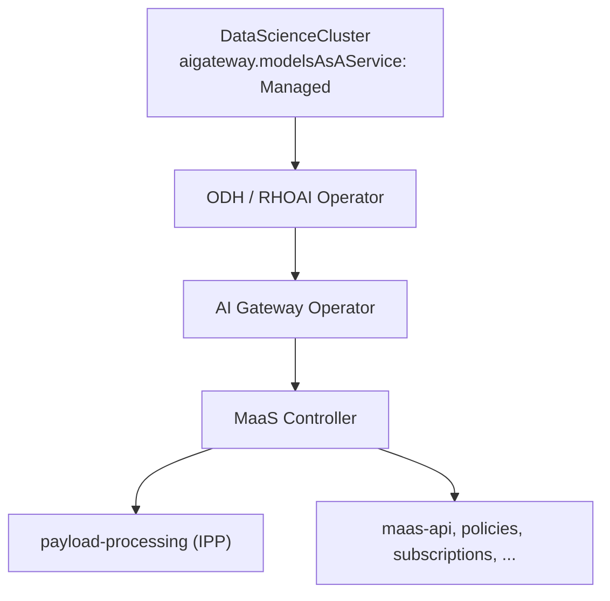
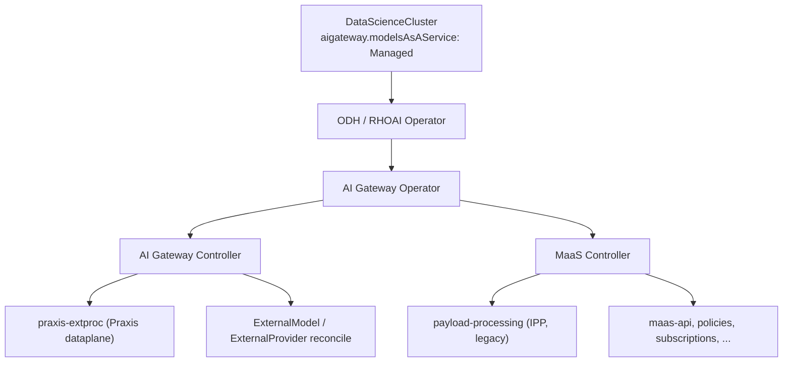

# ai-gateway-controller — Design

Architecture decisions are maintained in the Open Data Hub ADR repository.
The External Model/Praxis two-plane decision is tracked as
[ODH-ADR-MS-0005](https://github.com/opendatahub-io/architecture-decision-records/pull/165),
so this implementation repository does not carry a second authoritative copy.

## Status

**Phase 1:** `make build` (tidy, lint, test, binary) passes clean. Not yet
built into a released image, not yet pushed to a remote, not yet wired
end-to-end into a live `ai-gateway-operator` reconcile (see "Out of scope").

**Phase 2 (EA2):** the multi-tenant Praxis-vs-IPP fan-out and ExternalModel
control plane are implemented. `pkg/tenant` primarily watches
`MaasTenantConfig` — mirroring
maas-controller's own `TenantReconciler` — and, for every tenant whose
`metadata.annotations["maas.opendatahub.io/payload-processing-type"]` is
`"praxis"`, renders, SSA-applies, and (on switch-away or deletion) cleans
up a per-tenant copy of the vendored `praxis-extproc` manifests — replacing
Phase 1's single unconditional global install. `pkg/controller` reconciles
`ExternalModel` / `ExternalProvider` resources into the tenant-local ExtProc
overlay, credential projections, and Envoy-owned provider transport.

## Purpose

### ExternalModel handoff and transport cleanup ownership

`ai-gateway-controller` reads `payload-processing-type` and
`payload-processing-status` only from the tenant-local `MaasTenantConfig`.
It publishes ExternalModel serving state only after the selector is Praxis and
the handoff status is `steady`; the tenant reconciler owns the transition to
`steady` and `cleanup-complete`. An explicit `ipp` selector is a cleanup
request and does not wait for `steady`. A missing configuration is retained
for non-deleting models, while deleting models use controller ownership labels
and the model namespace to complete safe final-model cleanup.

Gateway-local provider `DestinationRule` objects and the route `EnvoyFilter`
carry the model namespace, tenant identifier, and current Gateway name and
namespace. On a Gateway move, the controller applies the new copy first and
removes only the old copy carrying the same tenant identity. Neighboring
tenant and foreign-controller resources are not candidates for deletion.

The pre-PR DestinationRule shape from `origin/main` was
`provider-<provider>` in the Gateway namespace with only
`app.kubernetes.io/managed-by=ai-gateway-controller` and
`inference.opendatahub.io/external-provider=<provider>` labels. It has no
tenant or Gateway identity and is therefore inherently ambiguous in a shared
Gateway namespace. The controller intentionally leaves such an object alone;
an operator must perform a targeted manual migration after identifying its
owner. New controller-owned rules are unambiguous and are cleaned up by the
normal handoff/finalizer path.

For one client-visible model, equal positive ExternalProvider weights are
eligible together and use Praxis' uniform `random` selection policy. An
omitted weight means one, weight zero disables that reference, and unequal
positive weights fail with `WeightUnsupported`. A single eligible provider
remains deterministic. Repeating the same provider across `ExternalModel`
objects with the same client-visible model name is rejected; otherwise that
provider would receive extra random-selection entries. This change adds overlay
selection metadata and checks compatibility before transport changes. It does
not add controller/ExtProc rollout coordination, proportional weighting,
health-aware selection, or retries. Final-provider withdrawal and empty-overlay
behavior remain outside this change in issue #106. Partial provider withdrawal
ordering remains a separate issue tracked in
[#108](https://github.com/opendatahub-io/ai-gateway-controller/issues/108).

### API translation opt-in compatibility

`MaasTenantConfig.spec.apiTranslation.enabled` is an opt-in rendering switch.
When omitted or false, ExternalModel overlays omit the Praxis provider profile
fields, the selected-provider translation filters are absent, and OpenAI
Chat Completions requests keep the client-supplied `model` value. Enabling the
setting permits Messages candidates and provider-specific request conversion;
it also allows the selected provider's `ExternalProviderRef.targetModel` to
replace the OpenAI request body's `model`, including when that provider speaks
the OpenAI-compatible API. There is no separate target-model rewrite setting.
This keeps translation-specific fields and their ExtProc compatibility
requirement opt-in while retaining the route and provider selection supported
by `origin/main` when translation is disabled.

If a deleting ExternalModel has no resolvable `MaasTenantConfig`/`AITenant` and
there are sibling models, deletion is conservative: it will not rebuild shared
Praxis serving state without a live, steady tenant handoff. The ExternalModel
finalizer remains until the owning handoff objects are restored or the sibling
models are removed. Final-model deletion can clean controller-owned state
using its namespace and ownership labels. Ambiguous pre-PR resources are never
removed by a label-only sweep.

`ai-gateway-controller` is the AI Gateway control-plane controller. Target
state (3.6): sibling of `maas-controller`, both deployed by
`ai-gateway-operator`:

```
ai-gateway-operator ──deploys──▶ ai-gateway-controller ──reconciles──▶ external models (control plane)
ai-gateway-operator ──deploys──▶ ai-gateway-controller ──installs──▶ praxis-extproc (dataplane)
ai-gateway-operator ──deploys──▶ maas-controller ──installs──▶ maas-api
```

This repo replaces the control-plane half of `payload-processing` (IPP):
watching `ExternalModel` / `ExternalProvider` and generating per-model
configuration. The dataplane half moves to **Praxis** (`praxis-extproc`).

Today `maas-controller` deploys the required infrastructure
(CRDs, Deployments, etc.) and the IPP repo watches `ExternalModel` /
`ExternalProvider`, doing both control-plane reconciliation and the ExtProc
dataplane. 3.5 ships only `maas-controller` + IPP; see
[Deployment architecture](#deployment-architecture).

**Phase 1 (implemented today)** vendors and installs `praxis-extproc`
manifests only.

**Phase 2 (EA2, implemented)** primarily watches `MaasTenantConfig` and, per
opted-in tenant, applies and cleans up its own per-tenant ExtProc resources.
It also watches `ExternalModel` / `ExternalProvider` and publishes dynamic
per-model routing, provider transport, and reference-only credentials
(credentials from outside a tenant namespace are delivered through copies; see
[Gateway attachments](#gateway-attachments)).

## Deployment architecture

### Current architecture (3.5)



- **Operator chain:** `DataScienceCluster` (`aigateway.modelsAsAService: Managed`) → ODH/RHOAI operator → AI Gateway Operator → **`maas-controller` only**.
- **`ai-gateway-controller` is not deployed in 3.5.** ExtProc dataplane is **IPP** (`payload-processing`), owned entirely by MaaS.
- **`maas-controller` bootstraps infrastructure** (CRDs, Deployments, gateway policies, etc.).
- **IPP owns both control plane and dataplane for external models:**
  - Watches `ExternalModel` / `ExternalProvider` and reconciles per-model configuration.
  - Runs the ExtProc dataplane (Deployment, EnvoyFilter, plugins ConfigMap).
- **`AITenant` is a MaaS-owned object:**
  - `maas-controller` bootstraps `AITenant/models-as-a-service` on startup.
  - AITenant reconciler drives tenant namespace, `MaasTenantConfig`, maas-api, and gateway-scoped platform resources per tenant.
- **IPP is injected through MaaS tenant reconciliation:**
  - Tenant reconcile deploys `payload-processing` based on the owning `AITenant`.
  - No `AITenant` field to pick dataplane backend — IPP is always what gets installed.

### 3.6 architecture (target)



- **AI Gateway Operator deploys two sibling controllers:**
  - **`ai-gateway-controller`** — external-model control plane (watch + reconcile `ExternalModel` / `ExternalProvider`) and installs `praxis-extproc` (Praxis dataplane).
  - **`maas-controller`** — MaaS platform (maas-api, gateway policies, subscriptions, telemetry, infrastructure bootstrap).
- **Control-plane / dataplane split (replaces IPP's dual role):**
  - **`ai-gateway-controller`** — deployment and reconciling of external models (per-model config generation, formerly in IPP).
  - **Praxis (`praxis-extproc`)** — ExtProc dataplane only.
- **`MaasTenantConfig` selects the dataplane backend per tenant (EA2 / Phase 2, implemented):**
  - `MaasTenantConfig.metadata.annotations["maas.opendatahub.io/payload-processing-type"] == "ipp"` selects **IPP** (`payload-processing`); absent, empty, or unrecognized values follow the current **Praxis** default (via `ai-gateway-controller`'s `pkg/tenant`). This annotation lives only on `MaasTenantConfig` — it is never mirrored to/from `AITenant` — so both controllers always read the same single source of truth from the same object they both watch.
  - Lets 3.6 support both backends during the Praxis migration, one tenant at a time, with a race-free handoff (see [Approach](#approach)) when a tenant swaps backends.
- **Multi-tenancy works the same way it does today:**
  - `MaasTenantConfig` / `AITenant` fan-out drives per-tenant namespaces, gateway binding, and dataplane install — no change to the tenancy model, only which ExtProc backend is selected.
- **Split of responsibilities:**
  - **`ai-gateway-controller`** — external-model control plane, `praxis-extproc` install, per-tenant Praxis/IPP dataplane selection.
  - **`maas-controller`** — MaaS auth, rate limits, API keys, model refs, subscription/policy concerns under that tenant.
- **Lifecycle toggle (decided):** `ai-gateway-controller` shares
  `AIGateway.spec.modelsAsAService.managementState` with `maas-controller`.
  There is no dedicated `AIGatewaySpec` toggle for this component: when MaaS
  is `Managed`, `ai-gateway-operator` deploys both siblings; when MaaS is
  `Removed`, both tear down (with the same teardown-grace-period window
  `maas-controller` uses, since praxis-extproc may still be serving traffic
  MaaS's own teardown depends on). `ModelsAsAServiceReady` reflects both
  Deployments.

## Approach

`praxis-extproc`'s manifests live in a separate repo, so they need
cross-repo, commit-pinned vendoring (the pattern `ai-gateway-operator` uses
for `maas-controller`). But `praxis-extproc`'s `deploy/overlays/odh` ships
placeholder values (namespace, gateway name, route names, and fixed resource
names) that must be rewritten by whoever installs it — vendor-and-apply
alone isn't enough; a post-render step is required too.

This repo combines both: pinned-commit vendoring into
`config/manifests/praxis-extproc/`, then a lightweight `controller-runtime`
manager (no `opendatahub-operator/v2` dependency) that primarily watches
`MaasTenantConfig` (`pkg/tenant`) — mirroring maas-controller's own
`TenantReconciler`, which watches the same object — and, for every tenant
whose payload-processing annotation is `praxis`, does kustomize build →
placeholder post-render → per-tenant rename/patch → SSA apply into that
tenant's Gateway namespace. On that path it also honors
`MaasTenantConfig.spec.payloadProcessing` /
`spec.payloadPreProcessing` (`replicas`, `autoscaling`, `resources`): when
`autoscaling` is set it creates gateway-namespace HPAs (parity with
maas-controller's legacy IPP behavior) and omits Deployment `spec.replicas`
so SSA does not fight the HPA; when autoscaling is removed it deletes the
orphaned HPAs. Both controllers watching the same primary
object (rather than `ai-gateway-controller` watching `AITenant` while
`maas-controller` watches `MaasTenantConfig`) means a backend-selection
write is a single watch event both sides observe together, with no
cross-object propagation lag between them.

`status.gatewayRef` and `status.phase` still live on `AITenant`, not
`MaasTenantConfig`, so this controller also Gets a tenant's owning `AITenant`
(via the `aitenant-name`/`aitenant-namespace` annotations maas-controller's
own `AITenantReconciler` already stamps onto every AITenant-managed
`MaasTenantConfig`) and gates apply on a populated `status.gatewayRef` plus
`DeployReady` (Ready `observedGeneration` matches generation, and phase is
not `Failed` — maas writes `gatewayRef` before the exclusive gateway claim,
so `Failed`/`GatewayClaimFailed` must not get EnvoyFilters or ExternalModel
routes). Pending with a current Ready stamp is enough (do not wait for
`Active`, which deadlocks on MTC Ready). Praxis-extproc also requires Gateway
existence / handshake; ExternalModel publish also requires `steady`. Both
CRDs are read as `unstructured.Unstructured` against hardcoded
`schema.GroupVersionKind`s rather than by importing
`models-as-a-service/maas-controller`'s Go types: that module's `go.mod`
pulls in `kserve`, `knative`, `KEDA`, `openshift/api`, and more, none of
which this controller needs to keep its own dependency graph minimal.

A `PraxisCleanupFinalizer` on the `MaasTenantConfig` (not `AITenant`)
guarantees a chance to delete what was applied when a tenant switches away
from `praxis` or the `MaasTenantConfig` is deleted (SSA only ever upserts
the current render set, it never deletes what falls out of it) — mirroring
maas-controller's own `tenant-cleanup` finalizer pattern on the same object.
Putting the finalizer on `MaasTenantConfig` rather than `AITenant` is
deliberate: maas-controller's own `AITenantReconciler.deleteTenantConfig`
already blocks `AITenant` deletion until `MaasTenantConfig` — and therefore
every finalizer on it, including this one — is fully gone, so `AITenant`
deletion ordering falls out of that existing mechanism for free, with no
separate coordination needed. `DeletionTimeout` bounds how long cleanup
retries before force-removing the finalizer without confirming cleanup
succeeded, same as before.

### Payload-processing backend swap handshake

Legacy IPP (maas-controller) and Praxis (this repo) share the same
Gateway-namespace resource names (`payload-processing`,
`payload-pre-processing`, etc.), so switching a tenant's
`payload-processing-type` annotation hands the same names off between two
independent controllers. Without coordination this is racy — see
`maas-controller`'s `tenantreconcile.AnnotationPayloadProcessingStatus`
doc comment for the full state machine this mirrors. In short:

- The status annotation (`maas.opendatahub.io/payload-processing-status`)
  lives only on `MaasTenantConfig` and has three meaningful states:
  - `cleanup-complete`: clear to claim. The party currently selected by
    `payload-processing-type` may CAS-claim and start deploying.
  - `steady`: praxis owns the dataplane and may resume/apply. Legacy must
    wait until praxis switch-off writes `cleanup-complete`.
  - **absent**: legacy steady when legacy is selected (existing tenants are
    assumed to run legacy IPP); blocked when praxis is selected (wait for
    legacy cleanup). Brand-new tenants are seeded with `cleanup-complete`
    at `MaasTenantConfig` creation time so their first deploy is never
    blocked by absent.
- Claiming for praxis (`EnsurePraxisMayDeploy` / `claimPraxisSteady`) writes
  `steady` via an optimistic-concurrency `Update`. Legacy's mirror claim
  deletes the annotation back to absent. Concurrent claims on the same
  `cleanup-complete` value: only one `Update` wins; the other observes
  `Conflict` and re-evaluates.
- Status itself is the durable claim — apply failures after a successful
  claim resume on the next reconcile because status is already `steady`.
- If a tenant namespace's `MaasTenantConfig` (always named `default-tenant`,
  in every tenant namespace) is temporarily missing, the
  ExternalModel reconciler treats selection as unknown: it retains existing
  serving state, does not infer a backend from `AITenant`, and waits for the
  owner to recreate the config. Cleanup is performed only after an explicit
  `ipp` selection (or the established deletion handoff), never merely because
  the selector object disappeared.
- After a full, successful switch-off cleanup (`Reconciler.cleanup`), this
  controller writes `cleanup-complete` (`MarkPayloadProcessingCleanupComplete`)
  so maas-controller may claim to absent and (re)deploy legacy IPP.

### Plugins ConfigMap migration gate (RHOAIENG-98846)

maas-controller fingerprints the live `payload-processing-plugins` ConfigMap
**before** IPP cleanup and only auto-migrates known-good baselines (product
default, or default with response `api-translation` enabled). Non-standard
ConfigMaps block cleanup until the operator sets
`maas.opendatahub.io/force-payload-processing-migration=true` on
`MaasTenantConfig` (after reviewing release notes). This controller adds
defense-in-depth: if an IPP-shaped plugins ConfigMap is still present at
Praxis apply time without that force annotation, apply waits rather than
`ForceOwnership`-overwriting custom plugin edits.

### Gateway attachments

`spec.gatewayRefs` ([RHOAIENG-90801](https://redhat.atlassian.net/browse/RHOAIENG-90801))
serves a model through explicitly selected tenant Gateways, including models in
user namespaces and models shared by several tenants
(`pkg/controller/attachment.go`). The contract is the RHOAIENG-90800
compatibility one-pager; this records how it is implemented.

- **Home attachment.** The tenant whose `MaasTenantConfig` is in the model
  namespace serves the model when `gatewayRefs` is omitted or names its
  Gateway, through the existing tenant-local path with unchanged resources,
  identifiers and deletion. An explicit binding never falls back to another
  Gateway.
- **Default tenant** ([RHOAIENG-101754](https://redhat.atlassian.net/browse/RHOAIENG-101754)).
  As in 3.5, where the default tenant served every namespace, a model without
  `gatewayRefs` in a namespace with no `MaasTenantConfig` is served by the
  default tenant (`AITenant` `models-as-a-service`) as an implicit extra
  attachment to its `status.gatewayRef`: the same identifiers, gating, status
  and lifecycle, with `spec` unchanged. A namespace an `AITenant` claims, a
  model that has the home finalizer and a single-namespace controller keep
  waiting for the namespace's own `MaasTenantConfig` instead. While the default
  tenant is not steady the model is `Pending` (`TenantNotSteady`), as is every
  attachment to a tenant that is not steady. Unlike an explicit binding, the
  implicit attachment follows the default tenant: while no single default
  `AITenant` publishes a Gateway it is removed and the model is `Pending`
  (`TenantNotResolved`). A default tenant selecting IPP leaves the model to its
  IPP, which serves every namespace: only the implicit attachment and its
  `status.gateways` result are removed. Adding `gatewayRefs` or a
  `MaasTenantConfig` to the namespace replaces the implicit attachment and
  removes its objects. A provider in a namespace with no `MaasTenantConfig`
  that no tenant has served reports only its own configuration and Secret
  (`Ready` or `Failed`): attachments apply its transport, and it serves a
  tenant's own models only once that tenant has applied it.
- **Extra attachments** resolve Gateway → owning `AITenant`
  (`status.gatewayRef`) → its `MaasTenantConfig` (`GatewayNotManaged`,
  `AmbiguousTenant`) and are gated per tenant by the handshake above: Praxis and
  `steady`, otherwise `TenantNotSteady` (existing state retained) or
  `TenantNotPraxis` (a cleanup request: the attachment's route is removed).
- **Status** ([RHOAIENG-90802](https://redhat.atlassian.net/browse/RHOAIENG-90802)).
  `status.gateways` holds one result per `gatewayRefs` entry, or for the
  implicit attachment: a `Ready`
  condition at the model generation with the attachment's own reason (the
  Gateway's reason for an unaccepted route, the winning model for
  `ModelNameConflict`), and `httpRouteRef` only while it is Ready. The
  top-level status is written in the same update: Ready requires every
  attachment, otherwise it reports the first failing one in `gatewayRefs`
  order. `httpRouteName` names a single attachment's route, is empty for
  several, and is cleared while an extra attachment is not Ready; a home route
  keeps its existing behavior. Removing a Gateway removes its result; removing every
  `gatewayRefs` entry removes them all.
- **Authorization.** The attachment's HTTPRoute is created in the model
  namespace first and the Gateway enforces its listener `allowedRoutes`.
  DestinationRules, credential copies and overlay entries are published only
  after the route's parent status for that Gateway is `Accepted=True`, and are
  withdrawn if acceptance is lost; `Accepted=False` reports the Gateway's reason.
  Default MaaS Gateways use `allowedRoutes.from: Same`, so user-namespace models
  need an administrator-configured namespace selector.
- **Identifiers.** Extra attachments use only new, disjoint forms: HTTPRoute
  `external-model-<model>-<hash12>` (`external-model--<hash12>` above 253
  characters, which no home route can match), Gateway DestinationRule
  `provider-<provider>-<hash12>`, `stable_id`
  `<modelNamespace>/<model>/<providerNamespace>/<provider>` (`sha256:` above 256
  bytes) and credential copy `agc-cred-<hash12>`. Hashed objects carry identity
  annotations and are never adopted or deleted when they do not match.
  Attachment DestinationRules are labelled
  `inference.opendatahub.io/attachment-tenant` instead of the provider's tenant
  label, so the provider's own reconciler never adopts or collects them.
  Model-namespace provider Services keep `provider-<provider>` for providers in
  the model namespace (see [Cross-namespace providers](#cross-namespace-providers)).
  Tenant-local cleanup, and a provider's cleanup when its namespace selects
  IPP, keep the transport attachment routes use.
- **Publication.** Each tenant keeps one overlay and one route EnvoyFilter. The
  tenant-local path publishes its own candidates and routes, then the admitted
  attachments; an attachment republishes the attachments and preserves the
  tenant's own published candidates and route patches verbatim. Both rely on
  ExternalModel reconciles running one at a time. Attachments are admitted per
  model, oldest first. A model-name conflict (across namespaces only: the
  tenant's own models win, then the oldest; same-namespace models share the
  name and are validated together as one selection group, as on the
  tenant-local path), a resolution or credential failure or more than 7
  providers (`TooManyProviders`) excludes the model: it loses its route,
  overlay entry, DestinationRules and copies. Over the 1024-candidate overlay
  limit (`OverlayCapacityExceeded`) a model keeps its accepted route but nothing
  else. Capacity is decided, and the handoff re-checked live, before anything is
  written into the tenant; a failed API read is retried, never treated as the
  model's failure. When the tenant's own models serve nothing (none resolve, or
  the last one is deleted), its attachments stay published and only its own
  transport is removed.
- **Credential copies.** Secrets in the tenant namespace are mounted directly,
  as before. Others (a provider or model override outside the tenant
  namespace) are copied, referenced key only, into the tenant namespace after
  route acceptance; the candidate references the copy, so the ExtProc mount
  logic is unchanged. Copies follow their source (a deleted source excludes the
  model) and are deleted when no accepted attachment route references them, and
  on tenant teardown or switch-away. This is the only departure from the
  reference-only credential model and it is exposure, not isolation: a copy is
  readable by anyone who can read Secrets or create pods in the tenant
  namespace, the same tier as tenant-local credentials. Writing copies needs the
  Secret permission from
  [RHOAIENG-90808](https://redhat.atlassian.net/browse/RHOAIENG-90808).
- **Lifecycle.** Removing a Gateway from `gatewayRefs` removes its route and
  collects the DestinationRules and copies no accepted route references and, in
  a namespace no Praxis tenant serves, the provider Services, ServiceEntries
  and selection sinks no route uses; the tenant's overlay drops
  the entry on its next publish, and until then the entry is inert because no
  route reaches it. A model with extra attachments carries the
  `inference.opendatahub.io/external-model-attachment-cleanup` finalizer:
  deleting it removes those objects for every extra attachment without
  waiting for any tenant, including tenant state whose route namespace or
  foreground deletion already removed, and the shared overlay and route filter are not
  rebuilt; the tenant ExtProc stops mounting a removed copy. The home
  attachment keeps its own finalizer and existing deletion, including its
  conservative wait for a steady tenant while siblings remain. A tenant serving
  only attachments keeps its ExtProc while its overlay is unreadable. A
  single-namespace controller (`--external-model-namespace`) serves no
  attachments from other namespaces.

### Cross-namespace providers

A provider reference with another namespace
([RHOAIENG-90804](https://redhat.atlassian.net/browse/RHOAIENG-90804),
`pkg/controller/referencegrant.go`) is served only when a `ReferenceGrant` in
the provider namespace permits `inference.opendatahub.io` `ExternalModel`s from
the model namespace to reference that `ExternalProvider` (or all of them). An
omitted or equal namespace stays local and needs no grant.

- **Authorization.** Grants are re-evaluated on every reconcile and watched, so
  adding a grant recovers the model and removing or narrowing it withdraws the
  reference; a revoked reference that is being served never keeps the last
  serving state, which is otherwise retained as before. A missing
  and an unpermitted provider report the same `RefNotPermitted` reason (for an
  attachment, also in its `status.gateways` result), so the reference does not
  disclose whether the provider exists; the model's permitted references keep
  serving. A same-named local provider never stands
  in. The grant authorizes only this reference: credentials follow the source
  rules below, and HTTPRoute-to-Gateway attachment still follows
  `allowedRoutes`.
- **Validation.** The provider is validated by the model reconciler, like an
  attachment's provider, because its namespace may have no tenant. Its status
  and its own namespace's transport keep their existing writer.
- **Identifiers.** Only new forms: model-namespace Service and ServiceEntry
  `provider-<provider>-<hash12>` (within 63 characters, labelled
  `inference.opendatahub.io/external-provider-namespace` instead of the local
  provider label, identity-annotated), which is also the overlay `cluster`;
  `stable_id` `<modelNamespace>/<model>/<providerNamespace>/<provider>`; Gateway
  DestinationRule `provider-<provider>-<hash12>`. A local provider whose name
  produces a hashed name is refused, as is the reverse. HTTPRoute rules are keyed by
  provider namespace and name, so same-named providers from two namespaces
  both keep their rules and candidates.
- **Credentials.** Inherited auth uses the provider's Secret in the provider
  namespace; a model override uses the Secret in the model namespace, with no
  fallback to a same-named provider-namespace Secret. A provider whose own
  Secret is not ready skips only the references that inherit it (`ProviderNotReady`);
  references that override it keep serving. Secrets outside the
  tenant namespace are delivered as credential copies, as for attachments.
  The provider's transport lives in the model namespace, so a grant trusts it:
  whoever can edit Services or HTTPRoutes there can redirect requests that
  carry the provider namespace's credential.
- **Tenant-local models.** A tenant's own model referencing another
  namespace's provider gets the attachment DestinationRule and copy, recorded
  on its HTTPRoute so collection keeps them; its overlay candidate is kept as
  the tenant's own. Model-namespace transport is collected after the reconcile,
  once no HTTPRoute in the namespace uses it.

### Consumer portal auth proxy

`pkg/consumerportal` reconciles the MaaS consumer portal OIDC auth proxy
(`kube-auth-proxy`) described in ODH-ADR-MS-0008. It watches
`MaasTenantConfig` and the default `AITenant`, independent of the RHOAI
Platform `GatewayConfig`. The MVP scope is limited to the default `AITenant`
in OIDC mode. OpenShift OAuth mode continues to use the existing consumer
portal route on the RHOAI Platform Gateway and requires no resources from this
controller.

When the default `AITenant` is ready, has a `status.gatewayRef`, sets
`spec.oidc.issuerUrl`, and does not set `spec.consumerPortal.enabled: false`,
the controller applies `config/manifests/consumer-portal/base` into
`MaasTenantConfig.status.infraNamespace`: a ServiceAccount, Deployment,
Service, and NetworkPolicy named `maas-consumer-portal-auth-proxy`. The proxy serves
TLS on port 4180 with a service-ca certificate, trusts
`odh-trusted-ca-bundle` for the OIDC issuer, and accepts traffic only from the
tenant Gateway and Authorino. Its OIDC callback is
`https://<Gateway HTTPS listener hostname>/oauth2/callback`.

The proxy reads its client and cookie secrets from
`maas-consumer-portal-auth-proxy-creds` in the same namespace. Until that Secret
exists the controller does not apply the proxy. Because the proxy lives in
another namespace than its `MaasTenantConfig`, cleanup uses the
`ai-gateway-controller.opendatahub.io/consumer-portal-cleanup` finalizer and
deletes only objects labeled as managed by this controller.

## Scope

### Phase 1 — `praxis-extproc` install (implemented)

- Vendor `deploy/overlays/odh` from `opendatahub-io/praxis-extproc@main` at a
  pinned commit (`hack/scripts/get-manifests.sh`) into
  `config/manifests/praxis-extproc/`, baked into the image via `Dockerfile`.
- `pkg/render`: kustomize build, placeholder post-render (target namespace,
  the `maas-default-gateway` placeholder, `PLACEHOLDER.maas-api-route.N`
  route names, `*.openshift-ingress.svc.cluster.local` FQDNs), and SSA-apply
  with a dedicated field owner (`ai-gateway-controller`). These primitives
  are tenant-agnostic; `pkg/tenant` (Phase 2) is what makes them per-tenant.
- PR/CI conventions — see [CONTRIBUTING.md](./CONTRIBUTING.md).

### Phase 2 — multi-tenancy + external models (EA2, implemented)

- **Implemented:** `pkg/tenant` primarily watches `MaasTenantConfig`
  (`maas.opendatahub.io/v1alpha1`) — mirroring maas-controller's own
  `TenantReconciler` — and, for every tenant whose
  `maas.opendatahub.io/payload-processing-type` annotation is absent or `praxis`,
  renders and applies a dedicated, per-tenant-named copy of the
  praxis-extproc resources (`{base}-{tenantID}`, the default/legacy tenant
  keeps the unsuffixed names) into that tenant's owning `AITenant`'s
  `status.gatewayRef` namespace once `status.gatewayRef` is populated,
  `DeployReady` holds (current Ready stamp, not Failed), the referenced
  Gateway object exists, and the payload-processing handshake allows deploy
  (`cleanup-complete` / `steady`). A secondary `AITenant` watch reacts to
  gatewayRef/phase changes that a
  `MaasTenantConfig`-only watch would miss. Tenants explicitly set to `ipp`
  are untouched — `maas-controller`'s own `TenantReconciler` owns their IPP
  deployment. The current product default is Praxis when the selector is
  absent; explicit `ipp` is the opt-out.
  `PraxisCleanupFinalizer` (on `MaasTenantConfig`) deletes a tenant's
  praxis-extproc resources when it switches away from `praxis` or its
  `MaasTenantConfig` is deleted; `--deletion-timeout` bounds how long that
  retries before force-removing the finalizer without confirmed cleanup.
  This controller does not write any `AITenant` at all (status or
  otherwise) — maas-controller's own `AITenant` reconciler owns it today.
- `pkg/controller` watches `ExternalModel` / `ExternalProvider` and publishes
  the content-addressed overlay, provider routes and transport, and Secret
  references. Tenant-local ExtProc runs `intelligent_route` and
  `credential_inject`; Envoy performs route reselection and the provider hop.

### Out of scope (explicitly deferred)
- Watching `AIGateway` (or any CR) from this controller. Lifecycle is
  owned by `ai-gateway-operator` via the shared
  `ModelsAsAService.ManagementState` toggle (see [3.6 architecture](#36-architecture-target));
  this controller only needs its `MaasTenantConfig` and `AITenant` watches.
- End-to-end verification of the `ai-gateway-operator` wiring described in
  [Repo layout](#repo-layout) (RBAC sufficiency, image-param injection,
  deploy/teardown alongside `maas-controller` under the shared MaaS toggle).
  `ai-gateway-operator` already vendors this repo's `config/self` (no
  `exclude_path` needed) and appends it when
  `ModelsAsAService.ManagementState == Managed` in
  `internal/controller/aigateway/aigateway.go`; a real vendoring/deploy run
  from this repo's side has not been confirmed yet.

## Inference API schema extension

[RHOAIENG-90800](https://redhat.atlassian.net/browse/RHOAIENG-90800) is a bounded,
additive extension to ODH-ADR-MS-0005's frozen migration baseline. AGC's
`api/inference/v1alpha1` types and generated `config/crd/bases` schemas source
the new fields. Retain the ADR's local API mirrors and CI drift checks;
MaaS installs the inference CRDs, and operator manifest pins propagate them.
AGC, MaaS and API owners agreed this extension separately from the migration
baseline.

`spec.gatewayRefs` is optional, with 1–16 unique namespace/name pairs when
present. Omission selects the tenant whose `MaasTenantConfig` is in the model
namespace or, in a namespace of no tenant, the default tenant (see
[Gateway attachments](#gateway-attachments)).
`status.gateways` uses the same full identity, optional `httpRouteRef`
name/namespace, and conditions keyed by type whose `observedGeneration`
refers to the model generation. Ready attests reconciliation/distribution;
aggregate Ready requires every requested attachment. `httpRouteName` remains
the legacy alias, populated for a single attachment only when its route is
in the model namespace. Other existing status fields remain available.

An omitted provider-reference namespace means the model namespace. Inherited
auth uses the provider-local Secret; an override uses the model-local Secret.
Secret references remain name-only. Preserve the installed schema's accepted
names and `auth.type: simple`, which 3.5 manifests use and which is served as
`apikey`, as IPP serves it.
The schema compatibility test pins the legacy MaaS validation baseline.
A provider reference to another namespace requires a `ReferenceGrant` (see
[Cross-namespace providers](#cross-namespace-providers)) and never substitutes
a local provider.

Schema installation alone does not enable serving these fields. Attachment
reconciliation and per-Gateway status are implemented (see
[Gateway attachments](#gateway-attachments)), as is provider authorization (see
[Cross-namespace providers](#cross-namespace-providers)); MaaS selection
belongs to the follow-up stories. Activation requires
aligned packaged schemas and serving implementations, verified tenant
cleanup/claim ownership (including shared models/providers), and the serving,
status, MaaS and installed-package checks.

## Dependencies

No cross-repo Go type imports (no dependency on `ai-gateway-operator/api/...`
or `models-as-a-service/...`): `pkg/tenant` watches `MaasTenantConfig` and
`AITenant` via `unstructured.Unstructured` + hardcoded
`schema.GroupVersionKind`s instead (see "Approach"). `ExternalModel` /
`ExternalProvider` watches, if they need
typed access to CRDs this repo doesn't already define, should default to the
same pattern unless a concrete need for generated deepcopy/defaulting
justifies revisiting it. Today only:

- `sigs.k8s.io/controller-runtime` (client + manager, leader election, health
  endpoints)
- `sigs.k8s.io/kustomize/api` (`krusty`) for kustomize build
- Standard `k8s.io/api`, `k8s.io/apimachinery`, `k8s.io/client-go`

## Repo layout

```
ai-gateway-controller/
├── cmd/manager/main.go                  # flags, manager bootstrap, registers pkg/tenant.Reconciler
├── pkg/render/
│   ├── kustomize.go                     # Build(): krusty kustomize build -> []unstructured.Unstructured
│   ├── postrender.go                    # PostRender(): placeholder substitution + namespace defaulting
│   └── apply.go                         # Apply(): SSA patch, field owner "ai-gateway-controller"
├── pkg/tenant/                          # per-tenant MaasTenantConfig -> praxis-extproc fan-out (Phase 2)
│   ├── constants.go, naming.go          # MaasTenantConfigGVK, AITenantGVK, base resource names, "{base}-{tenantID}" naming
│   ├── maastenantconfig.go              # unstructured MaasTenantConfig field accessors (no Go type import)
│   ├── aitenant.go                      # unstructured AITenant accessors (gatewayRef, DeployReady)
│   ├── migration.go                     # payload-processing backend swap handshake (existence-check + CAS claim)
│   ├── ownership.go                     # field-manager/label ownership check for cleanup deletes
│   ├── rename.go                        # Rename(): per-tenant resource rename + internal-reference patch
│   └── reconciler.go                    # Reconciler: primarily watches MaasTenantConfig, apply/cleanup + PraxisCleanupFinalizer
├── config/manifests/praxis-extproc/     # exact pinned upstream praxis-extproc manifests
├── config/manifests/external-model/    # controller-owned Kustomize composition and ExternalModel filters
├── config/self/{rbac,manager,default}/  # this repo's own deploy manifest (SA/ClusterRole/Deployment),
│                                         # namespace opendatahub. Kept as a sibling of config/manifests/
│                                         # (not nested under it) so ai-gateway-operator can vendor exactly
│                                         # config/self with no exclude_path needed.
├── hack/scripts/get-manifests.sh        # pinned-commit vendoring for config/manifests/praxis-extproc/
├── Dockerfile                           # single-repo build context
├── Makefile, tools.mk                   # build/test/lint/tidy/get-manifests/build-image targets
└── DESIGN.md                            # this file
```

### Flags (`cmd/manager/main.go`)

| Flag | Default | Purpose |
|---|---|---|
| `--image` | `quay.io/opendatahub/odh-praxis-extproc:odh-stable` | Replaces the `praxis-extproc:dev` placeholder image |
| `--manifest-path` | `/config/manifests/external-model/overlays/odh` | controller-owned kustomize entrypoint composing pinned upstream manifests and ExternalModel patches |
| `--maas-api-route-name` | `maas-api-route` | Base name; suffixed per tenant like every other resource. Best-effort — exact fidelity depends on maas-api's real HTTPRoute name and Istio's route-naming scheme |
| `--resync-interval` | `5m` | `RequeueAfter` once a tenant's resources are applied, so drift gets corrected periodically even without a new `AITenant` watch event |
| `--deletion-timeout` | `10m` | Maximum time to retry praxis-extproc cleanup for a tenant before force-removing `PraxisCleanupFinalizer` without confirming cleanup succeeded; `0` disables the timeout and retries indefinitely |
| `--kube-auth-proxy-image` | `RELATED_IMAGE_ODH_KUBE_AUTH_PROXY_IMAGE`, else `quay.io/opendatahub/odh-kube-auth-proxy:odh-stable` | Consumer portal auth proxy image |
| `--consumer-portal-manifest-path` | `/config/manifests/consumer-portal/base` | Kustomize entrypoint for the consumer portal auth proxy |
| `--authorino-namespace` | `kuadrant-system` | Authorino namespace allowed through the auth proxy NetworkPolicy |
| `--leader-elect` | `false` | Enable when running multiple replicas |
| `--metrics-bind-address`, `--health-probe-bind-address` | `:8080`, `:8081` | Standard controller-runtime endpoints |

## Tooling & conventions

See [CONTRIBUTING.md](./CONTRIBUTING.md) for what CI enforces. A few
decisions worth calling out here because they're not obvious from the config
alone:

- Arithmetic safety (overflow/underflow, unsafe numeric casts) is a
  code-review responsibility, not a lint — there is no mature Go tool for
  this.
- `go fix` modernizer suggestions are report-only (`make modernize`), not a
  CI gate.
- KAL (`kube-api-linter`) and `crdify` are not adopted — both only apply once
  this repo defines its own CRD types, which it doesn't today.
- Image publishing goes through Konflux (`.tekton/` PipelineRuns), not a
  GitHub Actions release workflow.

## Open questions (non-blocking, tracked)

- A computed per-tenant resource name over 63 characters (possible even
  within the CRD's 41-character `AITenant` name limit, since that limit
  was sized against maas-controller's own longest base name, not
  praxis-extproc's longer `payload-processing-plugins`) is logged and
  skipped rather than retried; revisit if this needs surfacing more
  visibly (event, status, metric) once status is written.
- Whether `payload-processing-reader`'s RBAC needs to grow once more Praxis
  filters land (today's rules cover exactly the `request_id` /
  `json_body` filter chains in use).
- `Params.MaaSAPIRouteName`'s fidelity is unverified against a live
  maas-api `HTTPRoute` — revisit once this controller integrates with one.
- End-to-end verification of the `ai-gateway-operator` wiring described in
  "Out of scope" (RBAC sufficiency, shared-MaaS-toggle deploy/teardown).
- This repo has no git remote yet, so none of `.github/workflows/*` have
  actually executed — they're believed correct against the Makefile targets
  but unverified in GitHub Actions.
